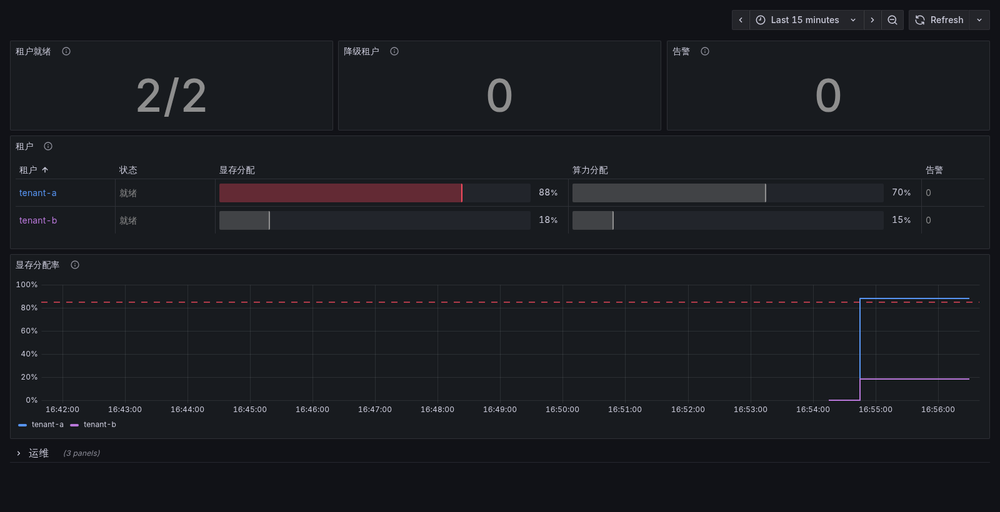

# gputenant

[](https://github.com/zhexizx/gputenant/actions/workflows/ci.yml)
[](https://github.com/zhexizx/gputenant/actions/workflows/e2e.yml)
[](LICENSE)

基于 Kamaji 托管控制面和 HAMi GPU 虚拟化的多租户 GPU Kubernetes 平台，跑在单机 kind 上。**GPU 由 nvml-mock 模拟**，没有在真实 GPU 上验证过（见[局限](#局限)）。

- 每个租户有独立的 Kamaji 控制面和独立的工作节点（`kindest/node` 容器）。
- HAMi 按显存和算力切分 GPU：同一租户内的多个 Pod 可以共享一张卡，不能跨租户共享。
- `gputenant` 用 14 个可重跑的步骤开通一个租户，提供 CLI、REST API、`/metrics` 和 Grafana 看板。
- 核心实验：Konnectivity 隧道断开或 HAMi webhook 挂掉时，GPU Pod 会被静默放行、绕过 HAMi 核算。现在每个租户默认部署 ValidatingAdmissionPolicy，把这种情况改为明确拒绝，并用 Prometheus 告警发现故障。



*Grafana 看板（`scripts/dashboard.sh up`）：只回答三个问题——平台有没有问题、每个租户的 GPU 分出去多少、出问题时是哪个租户哪条告警。颜色只表示异常：tenant-a 显存分配 88%，超过 85% 阈值，所以变红。图里的 GPU Pod 是演示用的。*

## 主要结果

| 结果 | 数据 | 证据 |
|---|---|---|
| 隧道断开时，默认配置静默放行 GPU Pod | `kubectl apply` 0.2 秒返回成功；Pod 交给 `default-scheduler`，没有 HAMi 注解，之后 Pending 或 `Failed` | `docs/failure-report.md` |
| 方案 A（webhook `failurePolicy=Fail`）的代价 | 隧道断开期间租户里所有新 Pod 都被拒绝，包括不申请 GPU 的 | 同上 |
| 方案 B（ValidatingAdmissionPolicy，已默认部署） | 只拒绝 GPU Pod，报错 `GPU Pod must use hami-scheduler`；普通 Pod 照常创建 | 同上，TC-09 |
| 告警 | 计划里的 `KonnectivityAgentUnavailable` 在隧道断开 351 秒里没有触发；新增的 `ApiserverToNodePathDown` 86 秒、`KonnectivityAgentDisconnected` 136 秒 firing | 同上 |
| 开通步骤 | 14 个 Step，每步 `Check`/`Apply`/`Delete`，中途 kill 后重跑能接着做完 | `internal/tenant/plan.go`、`results/cli-20261108-165831/` |
| 开通耗时 | 3 次从零开通 t4×2 租户的中位数 214.5 秒（214.3、214.5、221.7） | `results/measure-x-20261109-140325/` |

开通耗时的测量条件：WSL2 + Docker Desktop（24 CPU、16 GB），管理集群已就绪、镜像已构建，同时运行着另外两个租户。最慢的三步是 monitoring（安装 Prometheus，约 60 秒）、calico（约 55 秒）、images（导入本地镜像，约 30 秒）。

## 架构

```
宿主机 Docker（kind 网络 172.18.0.0/16）
├── kamaji-control-plane        管理集群：Kamaji、cert-manager、MetalLB
│   └── tenants 命名空间
│       ├── tenant-a 控制面      TenantControlPlane（apiserver、etcd、konnectivity-server），MetalLB 分配 LB IP
│       └── tenant-b 控制面
├── tenant-a-worker             工作节点（kindest/node），经 Konnectivity 隧道连回控制面
│   └── Calico、kube-proxy、nvml-mock、HAMi（webhook、scheduler、device-plugin）、
│       准入策略、Prometheus 和 4 条告警
├── tenant-a-api-proxy          socat，把租户 apiserver 暴露在 127.0.0.1:16443 起
└── tenant-b-worker / tenant-b-api-proxy
```

开通一个租户的 14 步：`tenants-namespace`、`control-plane`、`admin-kubeconfig`、`api-proxy`、`kubeconfig`、`worker-node`、`join`、`kube-proxy`、`calico`、`images`、`nvml-mock`、`hami`、`admission-policy`、`monitoring`。

## 运行

依赖：Docker（至少 8 GiB 内存，两个租户实测约 5 GiB）、kind、kubectl、curl、git、Go 1.26。helm 和 jq 由 `scripts/00-tools.sh` 校验后装到 `.tools/bin`。本地只在 WSL2 + Docker Desktop 上测过；CI e2e 跑在 GitHub Actions 的 Ubuntu runner 上。

```bash
./scripts/up.sh                  # 管理集群、镜像，再用 CLI 开通 tenant-a（a100×1）和 tenant-b（t4×2）
./tests/run-all.sh               # TC-00~09
./scripts/e2e.sh                 # CLI 开通（已完成的步骤跳过）→ gputenant verify → TC-00~09
./experiments/run.sh             # 降级实验：基线 → 方案 A → 方案 B → webhook 故障 → 告警
./experiments/restore.sh         # 实验被强行中断后恢复
./scripts/verify-from-scratch.sh # 删除、从零重建、跑全部测试
./scripts/dashboard.sh up        # API + Prometheus + Grafana（先 docker build -t gputenant:dev .）
./scripts/down.sh                # 只删除本项目的资源
```

### CLI

手动使用前先 `source scripts/lib.sh`（设置 `KUBECONFIG` 和 `GPUTENANT_HOME`）：

```bash
bin/gputenant create tenant-c --gpu-profile t4 --gpu-count 2  # 可重跑，已完成的步骤跳过
bin/gputenant status tenant-c   # 只读，约 3 秒：每一步的状态、GPU 容量和分配量、firing 的告警
bin/gputenant verify tenant-c   # 冒烟测试，会重启 kube-proxy、跑一个短暂的 GPU Pod
bin/gputenant delete tenant-c   # 按相反顺序删除，只建了一半的租户也能删干净
```

`status` 在步骤没做完或有状态告警 firing（degraded）时退出码非 0。

### REST API

`bin/gputenant serve` 默认只监听 `127.0.0.1:8080`，因为它能开通和删除租户，没有鉴权。

```bash
curl -X POST localhost:8080/tenants -d '{"name":"tenant-c","gpuProfile":"t4","gpuCount":1}'  # 202 + 任务
curl localhost:8080/tasks/<任务 ID>     # 进度；API 重启后旧任务返回 404
curl localhost:8080/tenants/tenant-c    # 每次重新跑 Check，状态以集群为准
curl -X DELETE localhost:8080/tenants/tenant-c
curl localhost:8080/metrics
```

同一租户已有任务在跑时，`POST` 和 `DELETE` 返回 `409` 和那个任务。

### 镜像和看板

镜像 `ghcr.io/zhexizx/gputenant`（CLI 和 API，内含 docker CLI 和 helm）要用宿主机网络、挂载 `docker.sock`，并以当前用户运行，否则写出来的 kubeconfig 属于 root。`scripts/dashboard.sh up` 已经处理好这些，Grafana 在 `http://localhost:3000`（匿名只读）。

WSL + Docker Desktop 上，本机访问不到宿主机网络里的端口，所以 API 经 socat 代理暴露在 `127.0.0.1:18081`（`docs/troubleshooting.md` 第 13 条）。

租户 kubeconfig 在 `kubeconfigs/<租户>/`（脚本把 `GPUTENANT_HOME` 设为 `kubeconfigs/`；单独运行 CLI 时默认是 `~/.gputenant/`）。它含集群管理员凭证，已被 `.gitignore` 排除。

## 测试和 CI

| 测试 | 内容 |
|---|---|
| TC-00 | 测试框架自检，不需要集群 |
| TC-01~02 | 控制面、API 地址、节点和 Konnectivity 隧道 |
| TC-03~05 | webhook 把 GPU Pod 交给 hami-scheduler；HAMi 分配、绑定、释放节点锁；3 个 Pod 共享一张卡 |
| TC-06~07 | 算力超分、显存超分被拒绝 |
| TC-08 | 租户隔离（需要两个租户） |
| TC-09 | 默认防护：准入策略和告警已部署，准入策略真的生效 |
| Go 单元测试 | 步骤编排、状态判断、HAMi 注解解析、API（202/409/404、重启后不误报、panic 不锁死租户）、指标 |

- **PR CI**（`.github/workflows/ci.yml`）：gofmt、go vet、`go test -race`、构建、shellcheck。
- **e2e**（`e2e.yml`，合入 `main`、每周定时或手动触发）：在 GitHub Actions 上从 GHCR 拉镜像，建管理集群，开通 tenant-a，跑 `verify`、TC-00~07 和 TC-09，约 9 分钟。TC-08 需要两个租户，受 runner 资源限制只在本地跑。
- **发布**（`release.yml`，打 `v*` tag 时）：`gputenant` 镜像，以及按固定 commit 构建的 `hami`、`nvml-mock` 镜像，供 CI 拉取。

## 验证记录

| 部分 | 结果 | 证据 |
|---|---|---|
| 环境 | 可以从零重建，租户由 CLI 开通 | `scripts/verify-from-scratch.sh` |
| TC-00~09 | 用 CLI 从零重建后全部通过 | `results/20261108-172558/` |
| 降级实验 | 隧道断开、webhook 挂掉、方案 A/B 都完成；加入默认防护后重跑，结论一致；2026-11-09 第三次重跑，探针结果和告警耗时都和前两轮一致 | `results/day4-5-20261103-113034/`、`results/webhook-down-20261103-115651/`、`results/day4-5-20261109-162805/`、`results/day4-5-20261109-165724/` |
| 默认防护 | 准入策略和 4 条告警，告警都真实触发过 | `scripts/05-tenant-guardrails.sh`、TC-09 |
| `create`、`delete` | kill 后重跑能接着做完，半成品租户能删干净 | `results/cli-20261108-165831/` |
| `status`、`verify` | `status` 在告警 firing 时判为 degraded；`verify` 在 hami-scheduler 停掉时报失败，恢复后通过 | `results/cli-status-verify-20261108-204408/` |
| 本地 e2e、PR CI | 通过 | `results/e2e-20261108-210436/`、PR #8 |
| REST API | API 被 `kill -9` 后重启：旧任务 404，半成品租户报 not ready，`gputenant_tenant_ready=0`；再次提交从断点续做 | `results/api-20261109-095837/` |
| 镜像和 GHCR | 本地构建的镜像能从零开通、删除租户；`v0.1.0` 的 release workflow 通过 | `results/image-20261109-100723/`、release run 42546815733 |
| CI e2e | GitHub Actions 上通过 | e2e run 42545273247 |
| Grafana 看板 | 11/11 重做为 5 个面板加一个折叠的“运维”行。查询用 promqltest 喂假数据验证了就绪、降级、未就绪 8/14、读取失败四种状态（含变异检查），又在真实 Prometheus 上逐个跑过；红色的渲染用临时调低阈值的副本看过。旧版 15 个面板的验证见 11/09 | `results/dashboard-promql-20261111-163159/`、`results/dashboard-redo-20261111-165529/`、`results/dashboard-20261109-101717/` |
| 开通耗时 | 见[主要结果](#主要结果) | `results/measure-x-20261109-140325/` |

## 设计

**代码组织**

- `cmd/gputenant` 是 CLI 入口，`internal/tenant` 是开通逻辑，`internal/api` 是 REST API。CLI 和 API 共用 `internal/tenant`。
- 管理集群（`scripts/01-management.sh`）和镜像构建（`00-build-images.sh`）留在 bash 里，CLI 的前置检查只确认它们已就绪。`scripts/02`、`03`、`05` 是 CLI 之前的 bash 开通脚本，留作参照。
- e2e 不重写成 Go：先用 CLI 开通租户，再跑 `tests/tc-*.sh`。

**CLI**

- 每一步实现 `Check`/`Apply`/`Delete`：重跑时跳过已完成的步骤，进度全靠查集群和 Docker 判断，不存状态文件。`delete` 按相反顺序执行，每一步都容忍资源不存在。
- `create` 只开放 `--gpu-profile`（a100、t4）和 `--gpu-count`。准入策略和告警总是部署，没有关闭开关；实验需要去掉时，由 `experiments/` 的脚本临时删除。
- 期望的 GPU 配置从租户里 nvml-mock 的 Helm release 读回，所以 `status`、`verify` 不需要 `--gpu-*` 参数；`create` 的参数和已装的不一致时直接报错。
- `status` 的每个 `Check` 限时 10 秒。前面有步骤没做完时，后面查不到的步骤显示为 pending，而不是报错。
- `verify` 是冒烟测试：环境检查，加上一个申请 `gpumem` 的 Pod 必须由 `hami-scheduler` 调度并运行，以及用 dry-run 确认跳过 webhook 的 GPU Pod 被准入策略拒绝。完整的测试交给 e2e。
- API 代理端口从 16443 开始，自动找第一个没被占用的。Kubernetes 操作用 `client-go`；Docker 和 Helm 调用命令行，封装在接口后面。

**API 和看板**

- `POST`/`DELETE` 返回 `202` 和任务 ID，同一租户同时只能有一个任务。只运行一个实例，任务放在内存里；重启后旧任务消失，租户状态只看 `Check`，不会因为重启前“任务成功”就报成功。
- `/metrics` 导出租户状态、开通耗时和结果、GPU 容量和已分配量（从 HAMi 注解计算）、各租户 firing 的告警。租户状态由后台每 30 秒刷新成快照；读不到告警时不导出告警数，免得被当成 0。
- 告警不经 apiserver 代理查询：那要经过 Konnectivity 隧道，隧道断开时正好查不到。改为在节点内 curl 租户 Prometheus 的 ClusterIP。
- 看板用的 Prometheus 和 Grafana 用 docker compose 跑，只抓取 API 的 `/metrics`（`deploy/`）。看板显示的是 **分配率**（HAMi 分出去了多少），不是利用率。
- 看板只回答三个问题：平台有没有问题、每个租户分出去多少、出问题时是哪个租户哪条告警。颜色只表示异常（正常灰色，未就绪、降级、告警、读取失败、分配率 ≥ 85% 红色），每个租户在所有面板里用同一个颜色；任务耗时和结果放在默认折叠的“运维”行。
- “2/2”“未就绪 8/14”这类文字由 PromQL 生成：`count_values` 把数字放进标签，`label_join` 拼起来，Grafana 只负责显示。状态写“未就绪”而不是“开通中”：节点挂掉时步骤数也会下降，指标区分不了这两种情况。

## 局限

- **nvml-mock 只覆盖调度和核算这一层。** HAMi 的 device-plugin、调度器和 webhook 都是真实运行的，所以分配、共享、超分拒绝和故障行为都是真实结果。容器内的运行时限制（HAMi-core 拦截 CUDA 调用，限制显存和算力）没有验证：驱动是假的，测试 Pod 里还设了 `CUDA_DISABLE_CONTROL=true`。没在真实 GPU 上验证之前，不能说运行时隔离有效。
- 同一张卡只能被同一租户内的 Pod 共享，不能跨租户共享。
- 把 `kindest/node` 容器接入为工作节点只是实验做法，不是生产方案。
- API 没有鉴权，只适合本机使用。
- 本地机器睡眠超过约 12 小时后，Calico 的 CNI token 可能过期，新 Pod 起不来，`status` 发现不了（`verify` 会建 Pod，应该能发现，没有实测）；重启 calico-node 即可（`docs/troubleshooting.md` 第 15 条）。
- Prometheus chart 每次开通都从 GitHub 下载，GitHub 出错时 `monitoring` 这一步会失败，只能重跑（`docs/troubleshooting.md` 第 14 条）。
- 没测的故障：隧道“黑洞”（server 以为 agent 在线，但数据不通，webhook 可能等满 10 秒超时）；方案 A 对 UPDATE 操作的影响。方案 A 已经不采用。

## 文档

- `docs/failure-report.md`：降级实验报告（隧道断开、webhook 故障、方案 A/B、告警）。
- `docs/troubleshooting.md`：搭建和实验中遇到的 15 个问题、根因和预防措施。
- `docs/work-summary-*.md`：按日期的工作记录。
